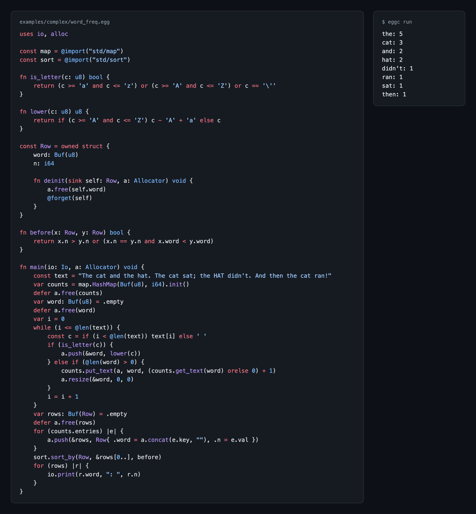

# Egg

[](https://app.codspeed.io/femto/egg?utm_source=badge)

**A systems language where a function's power is in its signature, and memory is safe without a GC or lifetime annotations.**

Egg compiles to portable C99. It is designed to be written by AI and read by people: strict errors with stable codes, diagnostics as JSON, and a spec you can paste into a prompt.

<p align="center">
  
</p>

- **Capabilities, not ambient power.** The core language can't do IO or allocate. A file declares `uses io, alloc`, and `main` passes the values down, so a signature shows what a function can touch.
- **Ownership without a GC.** A buffer has one owner. Use after free, double free and leaks are compile errors, with no lifetime annotations.
- **No undefined behaviour** outside `allow unsafe` code. Integer overflow, integer division by zero and out-of-bounds indexing panic.
- **Fast enough to be a systems language.** Near C on most programs, with every check on, and 1.3 to 5.6 times the Rust port's throughput on a real web app's benchmark routes, both with caches on ([numbers](#performance)).
- **Threads without shared data.** Owned values move between threads over channels.

## Performance

Every integer operation and every index in Egg is checked: overflow and out
of bounds panic, never wrap or corrupt memory. The checks cost little. On
four small programs ([bench/](bench/README.md), i7-9700K), the time relative to C:

| program | egg | rust (overflow checks on) | zig ReleaseSafe | CPython | Ruby 3.2 |
| --- | ---: | ---: | ---: | ---: | ---: |
| fib(40) | 1.53x | 1.62x | 1.51x | 95x | 44x |
| sieve, 50M | 1.10x | 1.04x | 1.19x | 27x | 23x |
| collatz, 3M | 1.07x | 1.37x | 1.34x | 55x | 26x |
| matmul, 800×800 | 2.31x | 1.11x | 1.23x | 345x | 164x |

So Egg is **25 to 149 times faster than CPython** and **21 to 71 times
faster than Ruby** on the same loops. matmul is behind Rust and Zig because
eggc does not yet remove bounds checks from inner loops.

The [HTTP example](examples/http_server/server.egg) keeps up with the same
design in C and Rust, about 54,000 to 67,000 small requests per second on
loopback, against about 21,000 for Node and 8,000 for Python
([details](bench/README.md#http-servers)). Go's `net/http` is ahead, with far
better tail latency: Egg has blocking IO and no event loop yet.

A larger program: [once-campfire-egg](https://github.com/femto/once-campfire-egg)
ports Basecamp's ONCE Campfire chat to Egg, measured with Basecamp's
[benchmark harness](https://github.com/basecamp/once-campfire-verification)
against the Rust port, whose HTML it matches byte for byte. So far it serves
the benchmark's routes, not the whole app. With both apps' caches on, in
requests per second (i7-9700K, OrbStack Linux VM, app on 4 vCPUs and load
generator on the other 4, 3 alternating rounds, 16 clients; Egg at `e152b5b`,
Rust's published image at `6dae2fd`;
[upstream PR](https://github.com/basecamp/once-campfire-verification/pull/14)):

| route | Rust | Egg | Egg/Rust |
| --- | ---: | ---: | ---: |
| room page | 13,789 | 49,051 | **3.6×** |
| messages page | 11,807 | 45,301 | **3.8×** |
| sidebar | 12,613 | 61,308 | **4.9×** |
| search | 12,620 | 52,558 | **4.2×** |
| avatar | 42,810 | 56,726 | **1.3×** |
| static CSS | 49,718 | 99,995 | **2.0×** |
| /up | 21,688 | 120,968 | **5.6×** |
| post a message | 1,452 | 2,409 | **1.7×** |

Every response was valid, and the harness's write audit verified every
acknowledged post. With 1,000 WebSocket clients on one busy room, Egg
delivered 209 messages/s to every client against Rust's 186, at 47 MiB peak
memory against 136.

Without its caches Egg renders and gzips every page and is far slower on
them; the [benchmark notes](https://github.com/femto/once-campfire-egg/blob/main/docs/benchmark.md)
have every route and both modes.

```bash
ruby bench/run.rb          # Egg, C, Rust, Go, Zig
ruby bench/run.rb --slow   # also Python and Ruby (about 7 minutes)
ruby bench/http.rb         # HTTP servers; needs wrk
```

[CodSpeed](https://app.codspeed.io/femto/egg) also tracks the compiler's
speed, smaller versions of these programs and the CPU cost per request of
the HTTP servers on every pull request
([bench/codspeed/](bench/codspeed/README.md)).

## Install

eggc and clutch come as native binaries for Linux (x86_64, arm64), macOS
(arm64, x86_64) and Windows (x86_64). eggc compiles through C, so you also need a C
compiler (cc; on Windows gcc, with `$env:CC = "gcc"` in PowerShell).

```bash
curl -fsSL https://raw.githubusercontent.com/femto/egg/main/install.sh | sh
```

```powershell
irm https://raw.githubusercontent.com/femto/egg/main/install.ps1 | iex
```

They install the latest release in `~/.egg` (`EGG_HOME`; `EGG_VERSION=0.1.0`
for another release) and check it against the release's SHA-256 sums. They
put the installation's `bin` (`$EGG_HOME/bin`, by default `~/.egg/bin`) on
your PATH: install.sh in your shells' startup files (`~/.profile`,
`~/.bash_profile`, `~/.bashrc`, `~/.zshenv`, fish's `conf.d`;
`EGG_NO_MODIFY_PATH=1` leaves them alone, so have yours run
`. ~/.egg/env` yourself), install.ps1 in your user PATH. Open a new
terminal and run `eggc --version`. Or download an archive from
[Releases](https://github.com/femto/egg/releases) yourself.

## Quick start

From a clone instead, eggc runs on Ruby 3.0+ (and a C compiler):

```bash
git clone https://github.com/femto/egg
cd egg
bin/eggc run examples/complex/word_freq.egg
```

Save this as `hello.egg` and run `eggc run hello.egg` (`bin/eggc` in a
clone):

```zig
uses alloc, io

fn greet(io: Io, a: Allocator, name: str) void {
    const msg = a.concat("hello, ", name)
    defer a.free(msg)
    io.print(msg)
}

fn main(io: Io, a: Allocator) void {
    greet(io, a, "egg")
}
```

Code blocks here are highlighted as Zig, because GitHub does not know Egg yet.

### Optional: a native eggc with Spinel

`bin/eggc` is a Ruby script, so the above needs nothing built. It is written
in the Ruby subset [Spinel](https://github.com/matz/spinel) compiles, so it
(and `clutch`) can also be native binaries that start in a few milliseconds
and need no Ruby. See [Native eggc](#native-eggc).

## The compiler catches it

Forget the `defer`, and the leak does not compile:

```text
hello.egg:4:11: error[E135]: 'msg' still owns its buffer when 'greet' ends; free it (a.free(msg)), return it or pass it on
```

Drop `io` from `uses`, and neither does the capability:

```text
hello.egg:6:8: error[E130]: 'greet' uses io (Io.print), but its module does not declare it; add `uses io` at the top of the file
```

Change a buffer while a slice of it is still needed:

```zig
const path = line[4..]
a.push(&line, '!')      // may move the bytes
io.print(path)
```

```text
slice.egg:7:12: error[E149]: 'line' cannot be changed here: the slice 'path' of it is used later
```

Once `path` is finished with, the same `push` is fine: a borrow ends at its last use.

## A longer example

```zig
uses io

const Shape = union(enum) {
    circle: i64
    rect: Size
    empty
}

const Size = struct { w: i64, h: i64 }

fn area(s: Shape) i64 {
    switch (s) {
        .circle => |r| { return 3 * r * r }
        .rect => |sz| { return sz.w * sz.h }
        .empty => { return 0 }
    }
}

fn total(shapes: []Shape) i64 {
    var sum = 0
    for (shapes) |s| {
        sum = sum + area(s)
    }
    return sum
}

fn main(io: Io) void {
    const shapes = [3]Shape{ Shape{ .circle = 2 }, Shape{ .rect = Size{ .w = 3, .h = 4 } }, .empty }
    io.print(total(shapes[0..]))   // 24
}
```

More in [examples/](examples), including an [HTTP server](examples/http_server/server.egg) with a thread pool and keep-alive, a [bytecode VM](examples/complex) and a [SQLite blog](examples/ffi).

## Documentation

- [Language spec](spec/core.md), with tested examples
- [Every error code](spec/diagnostics.md)
- Design doc: [English](docs/design.md) · [中文](docs/design.zh.md)
- [clutch](docs/clutch.md), the package manager
- [Editor support](#editor-support) and [debugging](#debugging)

## Commands

```bash
bin/eggc run examples/fib.egg        # 6765
bin/eggc emit-c examples/fib.egg     # show the generated C
bin/eggc build examples/fib.egg -o fib            # quick to build: cc -O0
bin/eggc build --release examples/fib.egg -o fib  # optimized: cc -O2
bin/eggc check file.egg --json       # diagnostics as JSON lines
bin/eggc build -g examples/fib.egg   # debug build: gdb/lldb break on .egg lines
bin/eggc run app.egg -- one two      # what follows -- goes to the program
bin/eggc run app.egg -lfoo -L lib    # link a C library (or `link "foo"` in an `allow unsafe` file)
bin/eggc run app.egg --pkg http=../egg-http/src   # @import("http") is ../egg-http/src/http.egg
bin/eggc spec                        # whole spec, for pasting into an AI
bin/eggc lsp                         # language server for editors (stdin/stdout)
ruby test/run.rb                     # all tests (CC=clang to switch compilers)
```

Packages are built with **clutch**, the package manager ([docs/clutch.md](docs/clutch.md)):

```bash
bin/clutch new chat && cd chat       # a program: clutch.toml and src/main.egg
../bin/clutch add http               # a dependency from the index (or --git URL, --path DIR)
../bin/clutch run                    # resolve, write clutch.lock, build and run
```

## Status

**eggc** is the first compiler. **v2** (modules, capabilities, integer types, pointers, `extern fn`, owned buffers) and **v3** (memory without a GC) are done. It is written in Ruby, aiming at the subset [Spinel](https://github.com/matz/spinel) compiles, and runs on CRuby 3.0+. Egg is young: expect breaking changes.

## Native eggc

Spinel compiles `eggc` and `clutch` to native binaries, which need no Ruby
(eggc still needs a C compiler, and clutch Git for git and index
dependencies). They say exactly what they say on Ruby: the Native workflow
checks the C eggc emits for every example, error test, std module and spec
example, and its diagnostics for every error test (`tools/native_check.rb`),
on Linux, macOS and Windows, for each release, weekly on main, and by hand
(Actions → Native → Run workflow) after a change Spinel might not compile. `tools/dist.rb` builds both, with the standard library beside
them:

```bash
ruby tools/dist.rb --spinel path/to/spinel   # dist/egg-VERSION-PLATFORM.tar.gz (.zip on Windows)
ruby tools/native_check.rb dist/egg-*/bin/eggc   # bin/eggc.exe on Windows
```

A native eggc finds the standard library in its install (`PREFIX/bin/eggc`
with `PREFIX/lib/std`), and a native clutch runs the eggc beside it.
`eggc --version` and `clutch --version` say the one version they share.

**Releasing.** Set `VERSION` in `lib/egg/version.rb`, merge it, then push
the tag `v` + that version:

```sh
v=v$(ruby -Ilib -regg/version -e 'print Egg::VERSION')
git tag "$v" && git push origin "$v"
```

The Release workflow refuses a tag that is not the version, builds and
checks the binaries on every platform (the Native workflow), and
publishes them with `SHA256SUMS`, `install.sh` and `install.ps1` as a
GitHub release.

The VS Code extension prefers `build/bin/eggc` while it is newer than every
compiler source, and falls back to `bin/eggc` on Ruby once you edit one;
rebuild to switch back.

## What eggc supports

The full definition, with tested examples, is [spec/core.md](spec/core.md).

<details>
<summary>The feature list, by version</summary>

v3 (memory without GC, and what realistic programs needed):

- A standard library in `lib/std/`, imported by module name without `.egg`:
  `const math = @import("std/math")`; a file import (`"lib/x.egg"`) may
  not leave its module's root. A package is a module by name too:
  `bin/eggc run app.egg --pkg http=DIR` makes `@import("http")` `DIR/http.egg` and
  `@import("http/client")` `DIR/client.egg`. `std/map` has `HashMap(K, V)`, in
  insertion order until the first remove: `init()` for str, `Buf(u8)` and
  integer keys, `init_with(hash, eq)` for other keys (`hash: fn(K) i64`,
  `eq: fn(K, K) bool`); a map with `Buf(u8)` keys owns their text and is
  looked up by any text (`m.get_text("apple")`, `m.put_text(a, k, v)`);
  `std/text` searches and takes text apart (`find`, `find_from`, `contains`,
  `starts_with`, `ends_with`, `trim`, `strip` (a part, not a copy), `split`,
  `parse_int`, `parse_float` (rounded to the nearest f64; inf when too big)).
  `std/sort` sorts, reverses and checks a mutable slice in place, also of
  elements that own buffers
  (`sort.sort(i64, &b[0..])`, numbers or text; `sort.sort_by(Row,
  &rows[0..], less)` by any order).
  `std/http` is HTTP/1.1 for servers: `parse` takes a request from the
  bytes received so far (null until it has all come, so a Poller can feed
  it), `read_request` reads one from a blocking `TcpConn`; a `Request` has
  `method`, `path`, `query`, `host`, `cookie`, `content_type`, `body`,
  `keep` and `upgrade`, and every header (`http.header(req, "Origin")` is
  a `?[]u8` of the request, not a copy). Responses are written
  whole (`write_response`, `append_response`), with validators the caller
  makes (`conditional(c, a, req, tag, ...)`: 304 when If-None-Match has
  it) and byte ranges (`ranged`); forms, cookies and multipart uploads are
  read with `field`, `fields`, `cookie` and `file`. Its client is
  `http://` only: `fetch(net, a, "GET", url, headers, body, opts)` on a
  connection of its own, following `opts.redirects` redirects;
  `send_request` and `read_response` on a connection kept for several;
  `parse_response` on received bytes. A `Response` has `status`, `body`,
  `keep`, `r.header(name)` and `r.reason()`.
  `std/ws` is WebSocket for servers: `is_handshake` and `handshake` (the
  101 response), frames out, and messages in with `take` (from received
  bytes) or `read_message`. `std/codec` has Base64, hex and form escaping;
  `std/sha1` SHA-1, in Egg, for the WebSocket handshake
- Mutable slices: `inout xs: []T` lends a writable view for the call,
  passed as `&x[lo..hi]` of a var array, a var or inout `Buf` or another
  inout slice; its elements change, but it cannot be reassigned or
  resized, and elements that own buffers cannot be assigned, but `@swap`, `@replace` and
  `@take` work
- A `for` loop over a buffer allows calls that take it, or what holds it,
  as `inout` when the callee cannot move, reassign or resize it (each
  function's summary of what it may change, through its callees too), so
  `s.bump()` works inside `for (s.items)` (E137 otherwise)
- Parameters borrow by default: `fn get(self: Map, k: str) ?i64` reads an
  owned value without taking it, so `m.put(a, k, (m.get(k) orelse 0) + 1)`
  works; `sink x: T` takes it over (`fn close(sink self: Db) void`), and
  moving a borrowed parameter is E144
- Errors you can tell apart: `catch |e|` names the error, an `anyerror`
  that compares with `==`, switches (`error.Name => ...`, with an `else`)
  and prints with `@errorName(e)`; `catch` and `orelse` may fall back to
  `return` / `break` / `continue` or to a block that leaves
- Choosing by type in generic code: `if (K == str) { ... } else if (K == i64)
  { ... } else { @compileError("...") }` is decided at compile time, and
  only the chosen branch is checked
- `if` with a value: `const sign = if (x < 0) -1 else 1`; both branches
  are expressions and the `else` is required
- `_ = f()` drops a value on purpose (not void, not an error union, and nothing owned)
- Text that is freed: a `Buf(u8)`, built with `a.append_str(&b, s)`,
  `a.append_int(&b, n)` and `a.append_float(&b, x)` and freed with
  `a.free(b)`; any text (str, `Buf(u8)`, a slice) is lent to a `[]u8`
  parameter, prints, and compares with `==`
- String escapes `\xNN` (any byte, so a str need not be UTF-8) and
  `\u{N}` (a code point, written as UTF-8): `"caf\u{e9}"`, `"\u{1f600}"`,
  `"\xff\xfe"`
- Text orders with `<` `<=` `>` `>=` by its bytes (`"ab" < "abc"`), and
  `a.leak(t)` copies any text, such as a `Buf(u8)` about to be freed, into
  a `str`
- `io.print(w, ": ", n)` prints several values and then a newline,
  allocating nothing; operands run left to right even when a later one
  changes a variable through `&x` (`f(x, bump(&x))` passes the old x);
  an operand that borrows what a later one changes through `&` or moves
  into a nested `sink` parameter, such as a slice in
  `f(b[0..], grow(a, &b))` or `b` in `f(b, eat(a, b))`, is E117
- Bitwise operators on integers: `&` `|` `^` `~`, and `<<` `>>` by any
  integer amount (`<<` drops the bits shifted out; an amount out of
  range panics); `x & 1 == 0` is `(x & 1) == 0`, and `a | b & c` needs
  parentheses. Hex and binary literals: `0xff`, `0b1010`
- Type aliases: `const Bytes = Buf(u8)` is a second name for the same type
- Constants: `const MAX = 8192`, `const OK: i32 = 0`, `const MB = KB * KB`:
  values known when compiling, visible through an import like functions
- Optionals: `if (x) |v| { ... } else { ... }` and `while (x) |v| { ... }`
- Standard error: `io.eprint(x, ...)`. Standard input (needs `uses alloc`
  too; failures are `error.IoFailed`): `io.read_line(a, &line) !bool` returns
  false at the end, `io.read_all(a) !Buf(u8)` returns the rest. Command-line arguments: `uses args`
  gives an `Args` value; `args.len()`, and `args.get(i)` returns a `str`,
  with the program's name at 0 and the first argument at 1;
  `args.env(name)` is an environment variable, a `?str`
- Time and random bytes: `uses time` gives a `Clock` (`clock.now()` and
  `clock.monotonic()`, in nanoseconds); `uses rand` gives a `Random`
  (`rng.fill(&b)` fills a `Buf(u8)` from the system's random source)
- Threads: `uses thread` gives a `Threads` value; `threads.spawn(f, x, ...)`
  returns an owned `Thread` to `join` or `detach`. Owned arguments move to the
  thread and plain values are copied, so outside `allow unsafe` raw pointers
  nothing is shared and no locks are needed. `threads.channel(T, n)` returns
  a `Receiver(T)` (with n of 0, `send` waits for the receiver), and
  `rx.sender()` a `Sender(T)`; `tx.send(v)` moves v, and `rx.recv()` gives
  null once every sender has closed and it is empty; `rx.recv_timeout(ms)`
  also gives null when ms milliseconds pass first. `rx.clone()` gives a
  pool of threads one queue: each value goes to one receiver. `select { rx
  => |v| { } tx.send(v) => { } timeout(ms) => { } closed => { } }` waits on
  several channels and runs one arm that can go, picked at random when
  several can
- Network: `uses net` gives a `Net` value; `net.tcp_connect(host, port)`,
  `net.tcp_listen(host, port)`, `net.udp_bind(host, port)` and
  `net.resolve(host, port)`. Sockets are owned and must be closed; everything
  blocks, so a server handles one connection at a time unless it hands each
  to a thread, or to a `net.poller()`, which serves many sockets from one
  thread without waiting on any (epoll, kqueue, WSAPoll or poll underneath).
  `conn.clone()` gives another handle to a connection (nothing buffered
  yet), so one thread can read it while another writes
- Open files, with `uses fs` and an `Fs` value `files`: `files.open(path)`
  gives a `Reader`, `files.create(path)` and `files.append(path)` a `Writer`;
  both are owned and must be closed, and a `Writer` ends with
  `try w.flush()`, or a failure in what is still buffered is lost when
  `close` runs
- Files: `uses fs` gives an `Fs` value; `fs.read(a, path)` returns the whole
  file as a `Buf(u8)` (so it needs `uses alloc` too), `fs.write(path, data)`
  replaces it, and failures are
  `error.NotFound`, `error.PermissionDenied`, `error.IsDirectory`,
  `error.InvalidPath` or `error.IoFailed`
- Directories and names: `fs.make_dir(path)`, `fs.open_dir(path)` (an owned
  `DirReader`; `d.next(a, &name)` gives one entry at a time),
  `fs.remove_file(path)`, `fs.remove_dir(path)` (empty only),
  `fs.rename(from, to)`, `fs.stat(path)` (a `Stat` with `kind` and `size`)
  and `fs.real_path(a, path)` (a `Buf(u8)`, so `uses alloc` too); `r.seek(pos)`
  on a `Reader`; new failures are `error.AlreadyExists`, `error.NotEmpty`
  and `error.NotDirectory`

From v2:

- Modules: `const m = @import("m.egg")`, then `m.f()`, `m.Point`,
  `m.Pair(i64)`; each file loaded once, cycles allowed; diagnostics name
  the file
- Per-platform files: where `m.egg` does not exist, `@import("m.egg")`
  (or a module's part) is `m_windows.egg` on Windows and `m_unix.egg`
  elsewhere; only that file is compiled, so its `link` and `extern fn`
  lines apply on its platform alone
- Capabilities: a file declares `uses alloc, io`; `main` receives the
  capability values (`fn main(io: Io, a: Allocator)`) and passes them
  down; `io.print(x)` replaces `@print`; `a.concat(s, t, ...)`,
  `a.int_str(n)` and `a.float_str(x)` build text as a `Buf(u8)` the caller frees
- **Capability check** (E130): following the call graph across files and
  generic instances, a function that uses a capability its file does not
  declare is rejected; hover in the editor shows what each function uses
- Integer types `i8`…`i64`, `u8`…`u64`, `usize`, all overflow-checked;
  literals take their type from context; `@as(T, x)` converts (checked)
- Floats `f32`, `f64` (IEEE 754: `1.0 / 0.0` is `inf`, no panic);
  `@as` to an integer panics if it does not fit; printed as the shortest
  decimal that reads back the same
- Raw pointers `*T`, `null`, `a.create(v)`; holding, passing and
  comparing them is safe, but pointer operations (taking an address with
  `&x` outside an `inout` argument, `p.*`, `@ptrAdd`, `@ptrCast`, ...) need
  `allow unsafe` in the file, which does not spread to importers; `p.*` on
  null panics
- Function values `fn(T) R`: passed, returned, stored in fields, called
- `extern fn toupper(c: i32) i32` (in an unsafe file) calls C; `uses io`
  on the declaration says what the C function does; `link "sqlite3"`
  (also in an unsafe file) links a C library (`-l`/`-L` on the command line too);
  `a.cstr(s)` and `a.str_from_c(p)` (which reads through a pointer, so
  needs `allow unsafe`) convert C strings. See
  [examples/ffi](examples/ffi) for libm and a SQLite blog
- Owned buffers `Buf(T)`: `a.alloc(n, v)`, `a.free(b)`, `a.resize(&b, n, v)`;
  indexed, sliced and iterated like arrays. The **ownership check**
  follows every path: no use after a move or free (E136), no leak (E135),
  paths and loop iterations agree (E134); `defer` and `errdefer` free on
  every way out. Structs, arrays and buffers holding buffers are owned
  too: struct fields are followed one by one (free and replace `v.data`),
  elements are swapped out with `@replace`/`@take`, and `a.free` frees
  everything a value holds
- Owned structs for resources: `const Db = owned struct { ... }` is
  checked like a buffer (a copy is a move, it must be ended on every
  path), and only its own file can build one or end one (`@forget(v)`), so
  callers release it only through its API (`db.close()`). With a
  `fn deinit(sink self: Db) void`, `a.free` ends ones held in a `Buf`, an
  array or a struct, so a pool is `Buf(Db)` filled with `a.push(&pool, db)`
- Character literals `'a'`, `'\n'`, `'\xff'`: one byte, an integer
  literal typed by its context, so `s[i] == 'a'` reads naturally
- Optionals `?T`: `null` or a T, unwrapped with `orelse` (a value, or
  `orelse return` / `break` / `continue`); `a.pop(&b)` returns a `?T`,
  `null` when b is empty

From v1:

- Types: `i64`, `bool`, `str`, `void`; structs with methods; enums;
  tagged unions `union(enum)`; arrays `[N]T`; slices `[]T`; error unions `!T`
- `const` / `var`, assignment to mutable variables, fields and array
  elements (str and plain slice elements are read-only); `if`,
  `while`, `for (xs) |x, i|`, `break`, `continue`, exhaustive `switch` with
  payload capture
- Parameters by value, `inout` (passed as `&x`, with exclusivity checked),
  or `comptime T: type`; generic functions and type functions
  (`fn Pair(comptime T: type) type { return struct { ... } }`)
- Errors as values: `error.X`, `try`, `catch`; `main` may return `!void`
- Builtins: `@len`, `@sizeOf`, `@typeName`, `@splat`, `@This`, `@import`,
  `@as`; for pointers `@ptrAdd`, `@ptrCast`, `@intFromPtr`, `@ptrFromInt`,
  `@strPtr`

Design choices worth knowing:

- **Slices are second-class**: they exist only as parameters, arguments,
  `for` subjects, local `const` or `inout` names and function results, so a
  view can never outlive its array (E116). A local slice borrows its owner
  until its last use: many readers or one writer (E149). A function may
  return a slice of its plain parameters (`fn trim(s: []u8) []u8`); which
  ones its signature says, by `from` (`?[]u8 from req`) or a default rule,
  never its body, so callers and separate compilation depend on the
  signature alone (E151, E152).
- **Left-to-right evaluation** on every C compiler: each call is evaluated
  into a temporary in source order.
- **No undefined behaviour** outside `allow unsafe` code: integer overflow,
  integer division by zero and out-of-bounds indexing panic.
- **Zig-style strictness**, all compile errors: unused locals, a `var`
  never changed, an ignored result or error, shadowing, missing returns,
  non-exhaustive switches, no implicit conversions.
- **Lazy generics**: a method of a generic type is checked only when
  called, as in Zig.

</details>

## Layout

```
bin/eggc               command-line driver
bin/clutch             the package manager (lib/clutch/, docs/clutch.md)
bench/                 benchmarks against other languages
docs/design.md         design doc (English; Chinese in design.zh.md)
editors/vscode/        VS Code syntax highlighting (install the .vsix)
editors/codeshot/      renders an .egg file as a PNG (screenshot/ is made with it)
lib/egg/lexer.rb       source -> tokens (newlines are significant)
lib/egg/parser.rb      tokens -> AST (recursive descent)
lib/egg/ast.rb         AST as Structs
lib/egg/loader.rb      the root file and its imports, merged into one program
lib/egg/typecheck.rb   types and Zig-style strictness checks
lib/egg/caps.rb        capability check along the call graph
lib/egg/own.rb         ownership check of buffers, along every path
lib/egg/codegen_c.rb   AST -> C99 (only the runtime helpers a program uses)
lib/egg/lsp.rb         language server (a tool: uses the json and uri stdlib, not Spinel)
lib/std/               the standard library: @import("std/math") is lib/std/math.egg
                       (math: min, max, abs, clamp; map: HashMap(K, V); text;
                       sort; http; ws; codec; sha1)
spec/core.md           the core language spec: types, scoping, semantics
spec/grammar.ebnf      the grammar, machine-readable
spec/diagnostics.md    every error code
examples/              programs with `// expect:` / `// panic:` / `// fails:` lines
                       (examples/lib/: modules they import)
                       (examples/complex/: larger programs: a parser, Dijkstra,
                       a bytecode VM, a CSV report, grouping, a tree rewrite,
                       resources closed on error paths)
test/errors/           programs that must fail with `// error: CODE @LINE`
test/run.rb            test runner, no gems
```

## Coding rules (to stay in the Spinel subset)

- No `send`, `define_method`, `method_missing`, `eval`
- AST nodes are Structs, handled with `case ... in`; every `case` ends in an
  `else` that raises, because Ruby does not check exhaustiveness
- No gems in the compiler (the test runner may use stdlib `open3`)

## Generated C

- Egg functions become `fn_<name>`, locals `v_<name>`, runtime helpers
  `egg_*`, so nothing an Egg program names can collide with C or the runtime
- Passes `-std=c99 -Wall -Wextra -pedantic -Werror` on gcc and clang
- Overflow checks use `__builtin_*_overflow` where the compiler has them
  (clang, gcc 5+), and portable C elsewhere or with `-DEGG_PORTABLE`
- Only `<stdio.h>`, `<stdlib.h>`, `<string.h>`, `<stdint.h>`, `<stdbool.h>`
  and `<inttypes.h>` by default; system calls only in a program that uses files,
  the network or threads

## Editor support

`editors/vscode` is a VS Code extension: highlighting, go to definition,
hover, outline, errors as you type (all served by `eggc lsp`) and
breakpoints. Install it with:

```bash
code --install-extension editors/vscode/egg-lang-0.0.5.vsix
```

Or in VS Code: Extensions view → `...` menu → *Install from VSIX...* →
pick `editors/vscode/egg-lang-0.0.5.vsix`. Reload the window and `.egg`
files are highlighted.

To work on the extension without repackaging, build it once, symlink the
folder and reload (rerun the build after changing `extension.js`):

```bash
(cd editors/vscode && npm install && npm run vscode:prepublish)
ln -s "$PWD/editors/vscode" ~/.vscode/extensions/femto.egg-lang-0.0.5
```

Rebuild the `.vsix` with `cd editors/vscode && npx @vscode/vsce package --no-dependencies`.

## Debugging

`eggc build -g` puts `#line` directives in the generated C and compiles with
`-g` (and `-O0`, unless `--release`), so gdb and lldb break, step and show
the stack in `.egg` source:

```bash
bin/eggc build -g examples/loops.egg -o build/loops
lldb build/loops -o "breakpoint set --file loops.egg --line 37" -o run
```

In VS Code (with the extension above, plus CodeLLDB or the C/C++
extension): open a `.egg` file, click the gutter to set a breakpoint, pick
*Debug .egg (lldb)* or *Debug .egg (gdb)* and press F5. The repo's
`.vscode/tasks.json` builds the current file into `build/` first.

Limits: variables show under their C names (`v_n` for `n`), and stepping
into a checked operation lands in a C runtime helper (`egg_add` and so on);
use step over.

## License

MIT; see [LICENSE](LICENSE).
